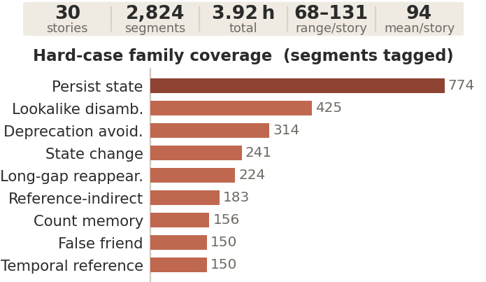

# VMem-Bench

**Does visual memory always improve the generated story?** VMem-Bench separates
retrieving relevant history from using it correctly in causal long-video generation.

**Paper:** *More Memory, Better Videos? A Controlled Study of Visual Memory in
Long-Video Generation* (2026). arXiv link will be added when available.

Yuzhuo Chen, Huafeng Shi, Xinyu Wang, Yulong Xu, Yucheng Wang, Haoqin Hong,
Guoxin Zhang, Zehua Ma, Weiming Zhang.

[Project page](https://suchenl.github.io/VMem-Bench/) · [中文说明](README.zh.md) · [Data](docs/DATA.md) · [Reproduction](REPRODUCE.md) ·
[Evaluate your method](scripts/evaluate_baselines/your_method/README.md) ·
[Dataset on Hugging Face](https://huggingface.co/datasets/Suchenl/VMem-Bench)

## What you can learn

Retrieval can improve entity recall and similarity to past appearances while
reducing precision and forbidden-entity avoidance. A relevant past can be wrong
for the present. Long-gap success can also come from appearance information in
the current prompt; it alone does not demonstrate long-term visual memory.

| Track | Question | Method input | Scoring evidence |
|---|---|---|---|
| **A: reference selection** | What useful visual evidence is retrieved before generation? | Current prompt; real segments revealed only after selection | Frozen film annotations |
| **B: generated outcomes** | What survives into generated pixels, including unwanted entities or obsolete states? | Chronological prompts and the method's own generated history | Authored story gold, pinned judges and separate identity proxies |

The paper studies **92 films / 16,548 segments** in Track A and **30 stories /
2,824 segments per condition** in the main Track-B comparison. These tracks use
different instances. The larger Track-B authoring pool is not the evaluated cohort.
Main Track-B results condition on **one rollout per story/condition, seed 2026**;
they do not measure seed variability. Last-seen is a privileged gold-ID diagnostic
control, not a deployable method or a matched-budget upper bound.

<details>
<summary>Evaluated Track-B cohort at a glance</summary>



This visual describes the constructed cohort, not representative movie-genre coverage.
</details>

## Quick start: connect your method without a GPU

```bash
git clone https://github.com/Suchenl/VMem-Bench.git
cd VMem-Bench
python3 -m pip install -e .
python3 scripts/evaluate_baselines/your_method/run_tracka_example.py \
  --movie-dir assets/trackA/BlenderOpenMovies/charge --limit 5
```

This is a plumbing demonstration with placeholder references, **not a scored
benchmark result**. It requires no source video, model weights or MemStrata.
Implement `compose` and `observe` using the [method template](scripts/evaluate_baselines/your_method/README.md).

For actual Track-A evaluation, obtain source videos using [DATA.md](docs/DATA.md),
configure model weights and a judge, then follow [running_eval.md](docs/benchmark/running_eval.md).
The optional MemStrata adapter needs a sibling [MemStrata checkout](https://github.com/Suchenl/MemStrata);
other methods do not need it. `python3 scripts/doctor.py` reports optional components.

## Run Track B or reproduce the paper

- **Your generator:** emit one clip per gold segment and use the
  [Track-B scoring contract](docs/benchmark/trackB_scoring.md).
- **Shared generator:** the [testbed](src/vmem_bench/testbed/README.md) implements
  four retrieval policies, no memory, and Last-seen on one generation backend.
- **Existing paper tables:** [REPRODUCE.md](REPRODUCE.md) points to frozen analysis
  JSON, deterministic renderers, the exact cohort and seed.
- **Original generation code:** `reproduction/generation-source.tar.gz` preserves
  the paper's generation revision without importing the development Git history.

Rendering saved tables, recomputing statistics from raw scores, and generating
new videos are distinct operations. Raw rollout videos and per-segment score
bundles are **not included in this initial code release**. Current distribution
boundaries and remaining work are recorded in [PUBLIC_RELEASE.md](docs/PUBLIC_RELEASE.md).

## Data and weights

The repository includes text gold/prompts; the dataset endpoint is
[Suchenl/VMem-Bench](https://huggingface.co/datasets/Suchenl/VMem-Bench).
Source film pixels, official LSMDC CSV/AD annotations, and model weights are not
redistributed. Track B needs no source films. Download instructions and exact
video layouts: [DATA.md](docs/DATA.md). Scoring-model installation:
[scripts/install_scoring_models.sh](scripts/install_scoring_models.sh).

## Fair evaluation

Select references before revealing the current segment. Give every compared
method identical inputs and shared preprocessing. Keep gold scoring-only;
never add evaluation-derived lexicons or per-story branches to adapters.
Last-seen's explicit gold-ID access is the diagnostic-control exception.
The benchmark package does not import MemStrata; method integrations live in adapters.

## Citation

```bibtex
@misc{chen2026vmembench,
  title={More Memory, Better Videos? A Controlled Study of Visual Memory in Long-Video Generation},
  author={Chen, Yuzhuo and Shi, Huafeng and Wang, Xinyu and Xu, Yulong and Wang, Yucheng and Hong, Haoqin and Zhang, Guoxin and Ma, Zehua and Zhang, Weiming},
  year={2026}
}
```

## License

Code: [Apache-2.0](LICENSE). Self-authored benchmark gold/prompts: CC BY 4.0;
retain the attribution notices in the data directories. Third-party materials
remain under their original terms. See [NOTICE](NOTICE).

